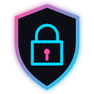
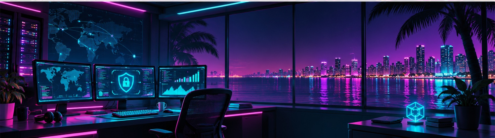

<div align="center">


<br>


<br>

<a href="https://github.com/Subhojeet1403"></a>
<a href="https://www.linkedin.com/in/subhojeet-ghosh-713805220/"></a>
<a href="mailto:asoksubho14@gmail.com"></a>

### CYBERSECURITY • ARTIFICIAL INTELLIGENCE • NETWORK DEFENSE

*Understand the attack. Strengthen the defense. Automate the intelligence.*


</div>

## `01` // WHO AM I?



```bash
┌──(subhojeet㉿vice-city)-[~]
└─$ whoami

Name       : Subhojeet Ghosh
Education  : M.Tech - Computer Science (Cyber Security)
University : KIIT University, Bhubaneswar
Graduation : June 2027
Focus      : Cybersecurity & AI-assisted security
Status     : Learning | Building | Researching
```

I'm an M.Tech student specializing in Cyber Security at KIIT University. My interests include vulnerability assessment, network security, security operations, and AI-assisted cybersecurity solutions.

I enjoy building practical security tools, investigating vulnerabilities, exploring security techniques, and developing intelligent systems that make security operations more effective.

## `02` // CURRENT OPERATIONS

| Mission | Focus |
|---|---|
| **Security Operations** | SIEM, threat detection, log analysis |
| **Vulnerability Management** | VAPT, CVE, CVSS, EPSS, CISA KEV |
| **AI Security** | LLMs, RAG, embeddings, vector databases |
| **Network Defense** | Cisco networking, firewalls, Wireshark |
| **Security Research** | OSINT, digital forensics, threat intelligence |

## `03` // PROFESSIONAL EXPERIENCE

### Cyber Security Intern — Amroha Police Cyber Security Internship Program
`June 2026`

- Worked on digital forensics involving simulated cybercrime cases.
- Explored OSINT techniques and threat intelligence.
- Studied PCI DSS compliance and payment security.
- Explored cryptocurrency transaction tracing.

### Additional Professional Experience — Details to be added

**[Company / Organization Name]**  
**[Job Title / Internship Role]**  
`[Start Month, Year] – [End Month, Year / Present]`

- [Add your responsibilities and contributions.]
- [Add tools, technologies, and platforms used.]
- [Add achievements or measurable outcomes.]


## `04` // FEATURED PROJECTS

### 01. LLM & RAG-Based Vulnerability Analysis and Risk Prioritization Framework

<div align="center">

</div>

[](https://github.com/Subhojeet1403/llm-rag-vulnerability-prioritization)

An AI-assisted vulnerability prioritization framework designed to analyze security findings and generate evidence-grounded risk assessments.

- Vulnerability enrichment using NVD and CISA KEV.
- Risk prioritization using CVSS, EPSS, CWE, asset criticality, and network exposure.
- Retrieval-Augmented Generation and vector search.
- ChromaDB / FAISS integration.
- OpenVAS / Nessus scanning workflow.
- Streamlit dashboard and remediation guidance.

`Python` `LLM` `RAG` `ChromaDB` `FAISS` `OpenVAS` `Nessus` `Streamlit`

[View repository →](https://github.com/Subhojeet1403/llm-rag-vulnerability-prioritization)

### 02. NetSage-AI — Intelligent Network Troubleshooting Assistant

An AI-assisted Cisco network troubleshooting assistant combining a Python rule engine with root-cause analysis.

- 30-case network troubleshooting dataset.
- Layer 2 to Layer 7 fault analysis.
- VLAN, DHCP, OSPF, ACL, NAT, and HSRP troubleshooting.
- Rule-based fault detection and AI-assisted explanations.

`Python` `AI` `Cisco Networking` `Rule Engine`

[View repository →](https://github.com/Subhojeet1403/NetSage-AI)


## `05` // TECH ARSENAL

### Cybersecurity & Information Security


### Security Tools


### Programming & Development


### AI, Cloud & Enterprise Security


## `06` // GITHUB PERFORMANCE

<div align="center">


<br>


<br>


</div>

## `07` // CONTRIBUTION TRACKER

<div align="center">



</div>

## `08` // CERTIFICATION COLLECTION

- Cisco CCNA — Switching, Routing and Wireless Essentials
- Cisco Python Essentials
- Red Hat System Administration — RH124
- Red Hat System Administration — RH134
- Fortinet NSE 1–3
- AWS Academy Cloud Foundations
- Deloitte Cyber Job Simulation — Forage

## `09` // CONNECT WITH ME

<div align="center">


<a href="https://www.linkedin.com/in/subhojeet-ghosh-713805220/"></a>
<a href="mailto:asoksubho14@gmail.com"></a>
<a href="https://github.com/Subhojeet1403"></a>

### OPEN TO OPPORTUNITIES

**Cyber Security Analyst | SOC Analyst | VAPT Analyst | Information Security**

*Building skills today. Securing tomorrow.*


</div>
